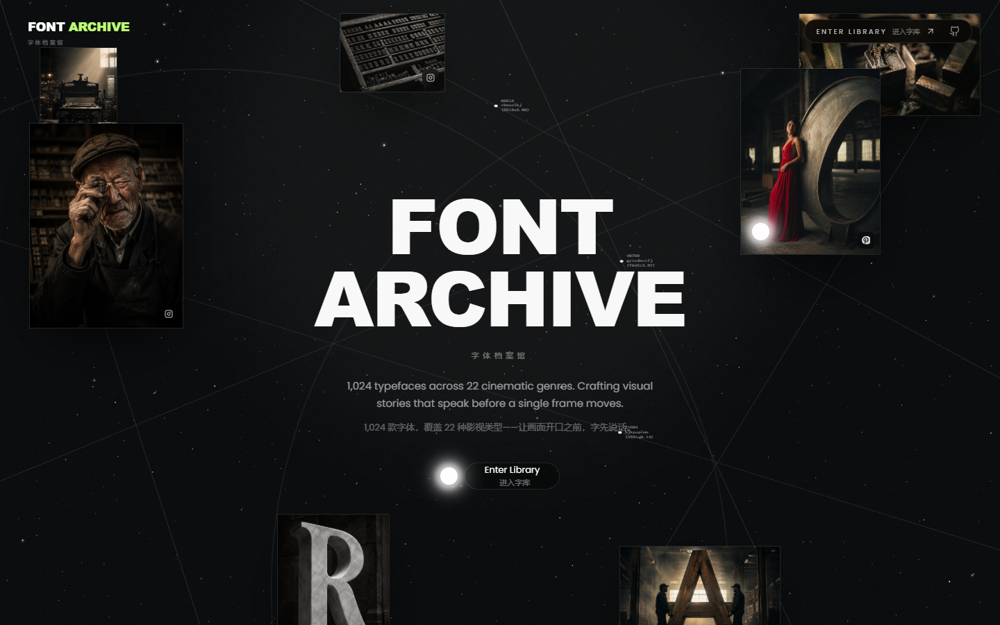
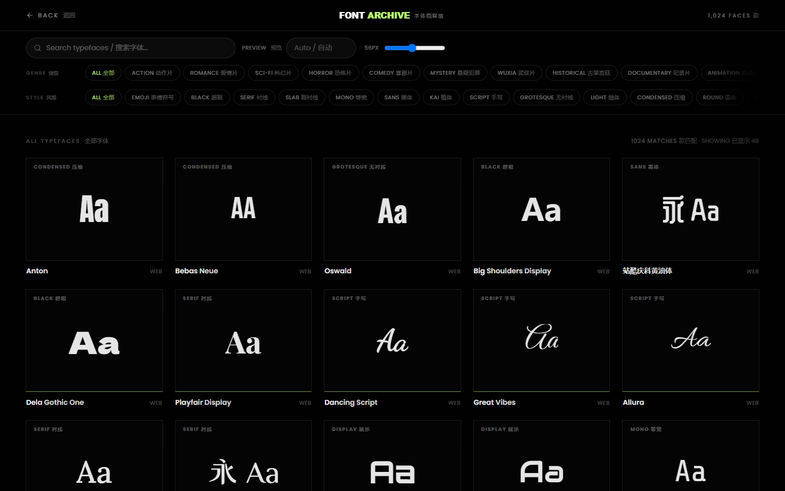
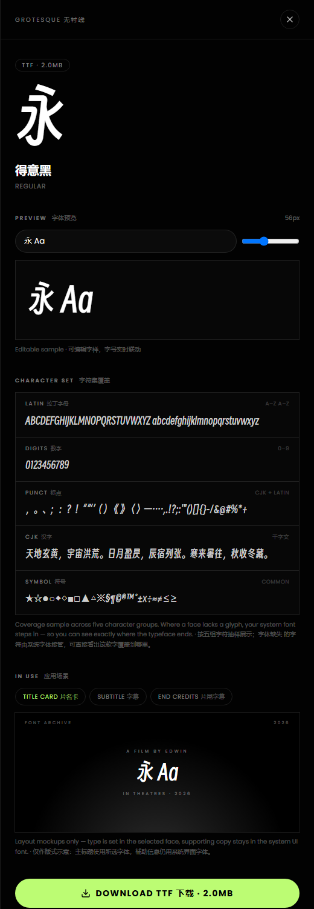

<div align="center">

# Font Archive · 字体档案馆

**A bilingual, genre-curated typeface archive for film.**
**面向影视创作的中英双语字体档案馆。**

[](./LICENSE)
[](https://react.dev)
[](https://vite.dev)
[](https://www.typescriptlang.org)
[](./CONTRIBUTING.md)

[Quick Start](#getting-started--快速开始) · [Font Catalog](#font-catalog--字体目录) · [Usage](#usage--使用指南) · [Contributing](#contributing--贡献方式) · [License](#license--开源许可证)

</div>



## Overview / 项目简介

**EN** — Font Archive turns a folder of fonts into a browsable type specimen library organized by
cinematic genre. Every card is set in the actual face, and every specimen opens into an editable
preview, a character-set coverage sample, and three in-use mockups: a title card, a subtitle line,
and end credits.

**中文** — 字体档案馆把一堆字体文件变成可按影视类型检索的字样库。每张卡片都用字体本身渲染；
点开任意一款，可以看到可编辑的预览、字符集覆盖示例，以及片名卡、字幕、片尾字幕三种应用场景演示。

**EN** — The project ships with 132 open-source typefaces across 22 genres. Connect your own font
folder and the same interface scales to 1,024 faces — without ever committing a font binary to the
repository.

**中文** — 仓库自带 22 种类型、132 款开源字体。接入自己的字体目录后，同一套界面可扩展到
1,024 款，且始终不会把字体文件提交进仓库。

## Features / 核心特性

| Feature / 功能 | What it does / 说明 |
| --- | --- |
| Genre-first browsing / 按类型检索 | 22 cinematic genres and 13 style filters, with live search across names, families and foundries. · 22 种影视类型与 13 个风格筛选，支持按名称、字族、厂商实时搜索。 |
| Live specimen / 实时字样 | The preview text and size slider drive every visible card at once. Empty input falls back to a per-font sample (`永 Aa` for CJK faces, `Aa` for Latin). · 预览文字与字号滑块同步驱动全部可见卡片；留空时按字体自动选样（中文字体 `永 Aa`，拉丁字体 `Aa`）。 |
| Character-set coverage / 字符集覆盖 | Five groups — Latin, digits, punctuation, CJK and symbols — set in the selected face, so you can see where the typeface ends and the fallback begins. · 拉丁、数字、标点、汉字、符号五组字符用所选字体排出，可直接看出这款字覆盖到哪里、从哪开始回退系统字体。 |
| In-use mockups / 应用场景演示 | Title card, subtitle and end-credit layouts set in the selected face. · 用所选字体排出片名卡、字幕条、片尾字幕三种版式。 |
| Lazy loading / 按需加载 | Faces larger than 20 MB stay unloaded until you ask for them. · 超过 20 MB 的字体默认不加载，点击后才载入。 |
| Download / 下载 | Local faces download straight from the font folder; web fonts are proxied to full TTF. · 本地字体直接从字库下载；在线字体经代理取完整 TTF。 |
| Bilingual by default / 默认双语 | Every heading, label and status line reads English first, Chinese second. · 所有标题、标签、状态文案均为英文在前、中文在后。 |
| Deep links / 深链 | `#/library/<faceId>` opens a specific specimen — used by the screenshots above. · `#/library/<faceId>` 可直接打开某款字体的详情，本文截图即由此生成。 |

## Screenshots / 界面预览

**Library / 字库** — every card is set in its own face; genre and style filters stay pinned to the
header. · 每张卡片都用字体本身渲染，类型与风格筛选固定在顶部。



**EN** — Preview, character-set coverage and three in-use mockups in one drawer. Supporting copy
stays in the UI font; only the headline switches to the selected face.

**中文** — 一个抽屉里给出预览、字符集覆盖与三种应用场景。辅助信息保持界面字体，只有主标题换用所选字体。



## Font Catalog / 字体目录

22 genres, 6 curated open-source faces each — 132 in total, 130 under SIL OFL 1.1 and 2 under
Apache 2.0. The full table with styles, licenses and recommended scenes lives in
**[docs/FONT-CATALOG.md](docs/FONT-CATALOG.md)**.
22 种类型、每类 6 款开源字体，共 132 款：130 款为 SIL OFL 1.1，2 款为 Apache 2.0。含风格、授权与
适用场景的完整表格见 **[docs/FONT-CATALOG.md](docs/FONT-CATALOG.md)**。

| Genre / 类型 | Focus / 侧重 | Faces |
| --- | --- | ---: |
| ACTION 动作片 | Compressed blacks and ultra-heavy weights built for impact. · 压缩粗黑，强调冲击力。 | 6 |
| ROMANCE 爱情片 | High-contrast serifs and flowing scripts with room to breathe. · 高对比衬线与流畅手写。 | 6 |
| SCI-FI 科幻片 | Geometric sans and terminal monospace for futures on screen. · 几何无衬线与终端等宽。 | 6 |
| HORROR 恐怖片 | Gothic, dripping and distressed faces that unsettle before the cut. · 哥特、滴血与破损质感。 | 6 |
| COMEDY 喜剧片 | Rounded, bouncy display types that land the joke. · 圆润夸张的展示字体。 | 6 |
| MYSTERY 悬疑犯罪 | Typewriter monospace and cold serifs for evidence and deduction. · 打字机等宽与冷峻衬线。 | 6 |
| WUXIA 武侠片 | Brush-written Kai and running scripts with the bones of ink. · 毛笔楷书与行草。 | 6 |
| HISTORICAL 古装宫廷 | Courtly serifs, seal scripts and period ornament. · 宫廷衬线、篆书与年代装饰。 | 6 |
| DOCUMENTARY 纪录片 | Quiet grotesques and editorial serifs that stay out of the way. · 克制的无衬线与编辑衬线。 | 6 |
| ANIMATION 动漫动画 | Playful rounded faces with cartoon energy. · 活泼圆体与卡通气质。 | 6 |
| WAR 战争片 | Stencil, industrial and stamped letterforms under pressure. · 模版、工业与压印字形。 | 6 |
| CRIME 刑侦法律 | Forensic monospace and procedural sans for case files. · 卷宗感等宽与程序化无衬线。 | 6 |
| FANTASY 奇幻玄幻 | Blackletter, runic and ornamental faces from other worlds. · 哥特黑体、符文与装饰字体。 | 6 |
| YOUTH 青春校园 | Handwritten markers and light sans for campus stories. · 手写马克笔与轻量无衬线。 | 6 |
| URBAN 都市职场 | Sharp geometric sans for glass towers and late-night offices. · 锐利几何无衬线。 | 6 |
| REPUBLIC 民国年代 | Letterpress serifs and vertical signage from the 1920s–40s. · 铅印衬线与竖排招牌。 | 6 |
| DISASTER 灾难求生 | Condensed, urgent type for countdowns and emergency bulletins. · 压缩、紧迫的提示字体。 | 6 |
| MUSICAL 音乐歌舞 | Expressive scripts and stage-poster display. · 表现性手写与舞台海报字。 | 6 |
| WESTERN 西部片 | Slab serifs, woodtype and dust. · 粗衬线、木活字与尘土感。 | 6 |
| FILM NOIR 黑色电影 | High-contrast serifs and shadowed sans in black and white. · 高对比衬线与暗调无衬线。 | 6 |
| SUPERHERO 超级英雄 | Chunky comic display with speed lines built in. · 厚重漫画字与速度线气质。 | 6 |
| EXPERIMENTAL 实验短片 | Deconstructed, variable and rule-breaking faces. · 解构、可变与反规则字体。 | 6 |

## Getting Started / 快速开始

### Requirements / 环境要求

Node.js 20 or newer, npm 10 or newer. No font files are required — the 132 open-source faces load
from Google Fonts at runtime.
需要 Node.js 20 及以上、npm 10 及以上。无需自备字体文件：132 款开源字体在运行时从 Google Fonts 加载。

### Installation / 安装

```bash
git clone https://github.com/EdwinZDZ/font-archive.git
cd font-archive
npm install
```

### Development / 本地运行

```bash
npm run dev
```

Open `http://localhost:5173`. The library route is `#/library`.
打开 `http://localhost:5173`，字库页为 `#/library`。

### Production Build / 生产构建

```bash
npm run build
npm run preview
```

`dist/` is a static bundle. Local fonts are served by a Vite middleware in development only — in
production, mount your font folder at `/jy/` (or drop the middleware and use the 132 web fonts).
`dist/` 是静态产物。本地字体在开发环境由 Vite 中间件提供；生产环境需把字体目录挂到 `/jy/`，
或仅使用 132 款在线字体。

### Connect a Local Font Library / 接入本地字库

**EN** — Point `FONT_DIR` at a folder of `.ttf` / `.otf` files and the dev server exposes it at
`/jy/`. Then regenerate the index so the UI knows what is there:

**中文** — 把 `FONT_DIR` 指向存放 `.ttf` / `.otf` 的目录，开发服务器会将其挂到 `/jy/`，再重新生成索引：

```bash
# macOS / Linux
FONT_DIR=/path/to/fonts npm run dev
FONT_DIR=/path/to/fonts npm run catalog   # scan fonts → src/data/localFonts.ts
npm run docs:catalog                      # optional: regenerate the catalog doc
```

```powershell
# Windows PowerShell
$env:FONT_DIR="D:\fonts"; npm run dev
$env:FONT_DIR="D:\fonts"; npm run catalog
```

The scan reads each font's `name` table — family, subfamily and any embedded license fields — and
classifies entries as `free`, `paid`, `banned` or `unverified`. It never guesses: anything it cannot
verify stays `unverified`.
扫描会读取每个字体的 `name` 表（字族、子族与内嵌授权字段），并把条目分为 `free`、`paid`、`banned`、
`unverified` 四档。它不做推测：无法确认的一律保持 `unverified`。

**EN** — If the folder is missing or empty, the app detects it at runtime and quietly falls back to
the 132 open-source faces, with a one-line notice in the library header.

**中文** — 如果目录不存在或为空，应用会在运行时自动检测并回落到 132 款开源字体，在字库顶部给出一行提示。

## Usage / 使用指南

### Search & Filter / 检索与筛选

**EN** — Search matches font name, family and foundry. Genre and style filters stack, and results
load 48 at a time through an intersection observer — no pagination buttons.

**中文** — 搜索匹配字体名、字族与厂商；类型与风格筛选可叠加，结果通过 IntersectionObserver 每次
追加 48 款，没有翻页按钮。

### Preview / 字体预览

**EN** — The header's preview field and size slider control every card. Leave the field empty for
automatic samples. Inside a specimen, the preview field is independent and drives the mockups below it.

**中文** — 顶部的预览输入框与字号滑块控制所有卡片；留空即按字体自动选样。详情页内的预览输入框独立
生效，并同步驱动下方的场景演示。

### Character Set Coverage / 字符集覆盖

**EN** — Five character groups are set in the selected face: Latin upper and lower case, digits,
CJK and Latin punctuation, the opening lines of the Thousand Character Classic, and common symbols.
Where a glyph is missing, the browser substitutes your system font — which is exactly what you would
see in production, so the panel shows the real stack rather than a made-up percentage.

**中文** — 面板用所选字体排出五组字符：拉丁大小写、数字、中英标点、《千字文》开头、常用符号。
字体缺失的字符会由浏览器用系统字体接管——这与真实排版所见一致，因此这里展示实际渲染结果，
不给出无法核实来源的覆盖率数字。

### In-Use Mockups / 应用场景演示

**EN** — Three layouts share the same string: a 2.39:1 title card, a subtitle frame, and an end-credit
block. Only the headline uses the selected face; supporting copy stays in the UI font so the
comparison remains honest.

**中文** — 三种版式共用同一段文字：2.39:1 片名卡、字幕画面、片尾字幕。只有主标题使用所选字体，
辅助信息保持界面字体，避免混淆对比。

### Deep Links / 深链

`#/library/f60` opens 得意黑 directly. Face ids come from `src/data/catalog.ts`.
`#/library/f60` 可直接打开得意黑；字体 id 来自 `src/data/catalog.ts`。

## Project Structure / 项目结构

```
font-archive/
├── src/
│   ├── components/        # StarField, LineField, IntroSequence, FontDrawer, Bilingual
│   ├── data/              # fonts.ts (curated 132), localFonts.ts (generated index)
│   ├── lib/               # font loading, download, face state, style names
│   ├── pages/             # Landing.tsx, Library.tsx
│   └── styles.css         # Tailwind 4 theme tokens
├── scripts/
│   ├── scan-fonts.mjs     # read name tables from a font folder
│   ├── build-catalog.mjs  # scan-result.json → src/data/localFonts.ts
│   └── build-docs.mjs     # fonts.ts → docs/FONT-CATALOG.md
├── docs/
│   ├── FONT-CATALOG.md    # 22 genres × 6 faces, bilingual
│   └── screenshots/
├── public/imgs/           # demo photography (placeholder only — see NOTICE.md)
├── README.md · CONTRIBUTING.md · NOTICE.md · LICENSE
└── vite.config.ts         # /jy/ font middleware + preview-only font download proxy
```

## Tech Stack / 技术栈

| Layer / 层 | Choice / 选型 |
| --- | --- |
| UI | React 19 + TypeScript 5.8 |
| Build | Vite 6 |
| Styling | Tailwind CSS 4 (OKLCH theme tokens) |
| Motion | Motion 12 (`framer-motion`) |
| Icons | Lucide React |
| Type data | Google Fonts CSS2 API; local `name` tables parsed in Node without dependencies |

## Data & Licensing / 数据与授权

**EN** — The MIT license covers the source code. Fonts and photography do not transfer: the 132
curated faces keep their OFL / Apache licenses, the 892 local entries are metadata only, and the
demo photography belongs to the original template. Read **[NOTICE.md](NOTICE.md)** before reusing
anything.

**中文** — MIT 许可证只覆盖源代码。字体与摄影素材不随之转移：132 款精选字体保留各自的 OFL / Apache
授权，892 条本地条目仅为元数据，演示图片归原模板所有。复用前请先读 **[NOTICE.md](NOTICE.md)**。

## Contributing / 贡献方式

**EN** — Issues and pull requests are welcome. A good font suggestion includes the family name, a
link to the official source, the license, and one genre it belongs to. See
**[CONTRIBUTING.md](CONTRIBUTING.md)** for the full checklist.

**中文** — 欢迎提交 Issue 与 Pull Request。推荐字体时请附上字族名、官方来源链接、授权方式，以及它
所属的类型。完整清单见 **[CONTRIBUTING.md](CONTRIBUTING.md)**。

## License / 开源许可证

- **Code / 代码** — [MIT](./LICENSE) © 2026 Edwin.
- **Fonts & images / 字体与图片** — not covered by MIT; see [NOTICE.md](./NOTICE.md). · 不在 MIT 许可范围内。

## Acknowledgements / 致谢

Layout language adapted from the VALMAX portfolio template by [qclay.design](https://qclay.design).
Type specimens served by [Google Fonts](https://fonts.google.com). Thanks to every foundry that
releases its work under an open license.
版式语言改编自 [qclay.design](https://qclay.design) 的 VALMAX 作品集模板；字样服务由
[Google Fonts](https://fonts.google.com) 提供。感谢所有以开放授权发布作品的字库与设计师。
